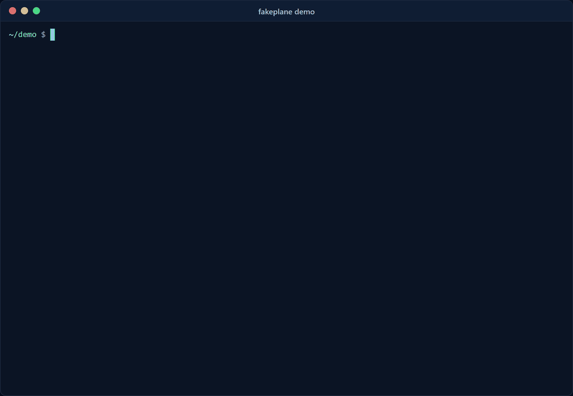

# fakeplane

**Know your agent works before your customers find out it doesn't.**



fakeplane gives your AI agent stateful fake versions of the systems it acts on (a Zendesk-style helpdesk, Slack, Linear, and any HTTP/JSON API) over plain HTTP and over MCP. You script the conversation, inject the failures production will throw at it (timeouts that actually committed, 429s, duplicate webhooks), and assert on what the agent **would have done**: exactly one reply, no refund above $100, ticket solved with the right tag, no customer contact details in Slack. It runs in CI and fails the build when the agent regresses.

```text
$ npx fakeplane run demo/scenarios --agent "node demo/agents/naive.mjs"

 FAIL  duplicate webhook and a rate-limited refund
   ✗ exactly one refund despite two webhooks
     expected exactly 1 generic.refunds.create effect(s), found 2: effect #1 (call #5, turn 1), effect #4 (call #10, turn 1)
   ✗ customer gets exactly one reply
     expected exactly 1 zendesk.ticket.reply effect(s), found 2: effect #2 (call #6, turn 1), effect #5 (call #11, turn 1)
 FAIL  refund reply times out after it was saved
   ✗ customer gets exactly one reply
 FAIL  large refund is escalated, not issued
   ✗ no refund above the $100 limit
   ✗ no customer contact details sent to Slack or the customer thread
     found 2 PII-shaped value(s): email "jo************om" in effect #4 text; phone "+1***********34" in effect #4 text

0 passed, 3 failed (3 scenarios) in 1.3s
```

Nothing left your machine. Every "send" landed in a fake that remembers it, so the assertions can count it.

## Why

Most teams test agents against canned responses or not at all, then learn about double replies and wrong refunds from customers. 2026 vendor surveys put the gap plainly: 74% of organisations say they trust their evals, but only 19% have a gate that blocks every bad release ([Harness](https://cms.harness.io/pdf/the-state-of-agentic-dlc-2026.pdf)), and 52% saw a failure after tests passed ([VB Pulse](https://venturebeat.com/vb-pulse-agentic-reliability-and-evals-report)). A study of 25,930 agent episodes found frontier models duplicate a write in 56-74% of episodes when the first attempt's outcome is ambiguous, and report success in 90% of the episodes where they did ([arXiv 2609.29095](https://arxiv.org/html/2609.29095)).

Record/replay tools freeze responses. fakeplane keeps **state**: a ticket you update stays updated, a refund you create shows up in the next lookup, a reply that "timed out" is still on the ticket when the agent reads it back. That is what you need to test retries, idempotency, and multi-step workflows.

## Quickstart (under 2 minutes)

Needs Node 18 or newer on Windows, macOS or Linux; CI runs the full suite on all three. fakeplane is not on npm yet, so install it from GitHub:

```bash
npx -y github:shmindmaster/fakeplane demo
```

The demo runs three scenarios against two bundled support agents. The naive one fails all three for real reasons (double reply after an ambiguous timeout, double refund on a duplicate webhook, a $1,250 refund plus customer email in Slack). The careful one passes.

Then start your own project:

```bash
npx -y github:shmindmaster/fakeplane init   # writes scenarios/, fakeplane.config.yaml, example-agent.mjs
npx -y github:shmindmaster/fakeplane run    # 1 passed
```

Replace `agent.command` in `fakeplane.config.yaml` with your agent, and change the scenario to your workflow. Once it's on npm, `npx fakeplane` replaces `npx -y github:shmindmaster/fakeplane`.

## How it works

1. **Seed** state from the scenario: tickets, users, Slack channels, Linear issues, orders.
2. **Start** the fakes on a random local port, as REST/GraphQL endpoints and as one MCP server.
3. **Deliver** each scripted user turn to your agent: a customer comment on a ticket, a Slack message, or a raw event. Duplicate deliveries reuse the same delivery id, like a redelivered webhook.
4. **Record** every call the agent makes and every side effect it would have caused, including writes that committed while the agent saw an error.
5. **Assert** on effects, calls and final state, then print pass/fail and write JUnit.

Your agent can be anything that runs:

| Mode | Scenario / config | Your agent gets |
|---|---|---|
| Command | `agent: { command: "python agent.py" }` | The turn as JSON on stdin, fake URLs in `FAKEPLANE_*` env vars. Run once per delivery. |
| HTTP | `agent: { url: "http://localhost:3000/webhook" }` | The turn as a JSON POST. |
| JS module | `agent: { module: ./agent.mjs }` | `default(turn, { env })` called in-process. |

Point the agent's API base URLs at the fakes, or connect its MCP client to `FAKEPLANE_MCP_URL`:

| Env var | Fake |
|---|---|
| `FAKEPLANE_MCP_URL` | MCP server (Streamable HTTP) exposing every fake's tools |
| `FAKEPLANE_ZENDESK_URL` | Zendesk-style REST: `/api/v2/tickets`, `/api/v2/tickets/{id}`, comments, tags, search, users |
| `FAKEPLANE_SLACK_URL` | Slack Web API: `chat.postMessage`, `chat.update`, `conversations.history/replies/list`, `reactions.add`, `users.info` |
| `FAKEPLANE_LINEAR_URL` | Linear-style GraphQL: `issue`, `issues`, `teams`, `viewer`, `issueCreate`, `issueUpdate`, `commentCreate` |
| `FAKEPLANE_GENERIC_URL` | JSON collections (`GET/POST /orders`, `GET/PATCH/DELETE /orders/{id}`) and custom routes |

Examples for an [OpenAI tool-calling loop](examples/openai/agent.mjs), an [Anthropic tool-use loop](examples/anthropic/agent.mjs) and an [MCP SDK client](examples/mcp-client/agent.mjs) are in [`examples/`](examples/README.md). The LLM examples pull tools from fakeplane's MCP server, so the model sees the same tool surface as in production.

## A scenario

```yaml
name: refund reply times out after it was saved
seed:
  zendesk:
    users:
      - { id: 100, name: Jordan Rivera, email: jordan.rivera@example.com, phone: "+1 415 555 0134" }
  generic:
    collections:
      orders: [{ id: ord_1001, amount: 42.5, currency: USD }]
      refunds: []
turns:
  - ticket: 1                         # customer comment on ticket 1 (created if missing)
    from: jordan.rivera@example.com
    text: "I was charged twice for order ord_1001. Please refund the duplicate."
faults:
  - op: zendesk.ticket.update         # or an MCP tool name, e.g. zendesk_update_ticket
    kind: timeout
    committed: true                   # the write landed; the agent only sees a 504
assert:
  - name: customer gets exactly one reply
    effects: zendesk.ticket.reply
    where: { ticket_id: 1 }
    count: 1
  - name: no refund above the order amount
    effects: generic.refunds.create
    where: { amount: { gt: 42.5 } }
    count: 0
  - name: ticket solved and tagged
    state: zendesk.tickets.1
    match: { status: solved, tags: { contains: refund_issued } }
  - no_pii: true
  - no_duplicate_effects: true
```

Full reference: [docs/scenarios.md](docs/scenarios.md).

### Assertions

| Assertion | Checks |
|---|---|
| `effects: <kind glob>` + `where` + `count`/`min`/`max` | Side effects, e.g. `zendesk.ticket.reply`, `slack.message.post`, `generic.refunds.create`, `linear.issue.*` |
| `calls: <op or tool glob>` + `where` + `ok` + count | Requests the agent made, e.g. "never called `zendesk_update_ticket` with `status: closed`" |
| `state: <path>` + `match` / `exists` | Final state, e.g. `zendesk.tickets.1`, `linear.issues.ENG-1`, `generic.collections.orders.o1` |
| `no_pii` | No emails, phone numbers, card numbers (Luhn-checked), SSNs, IBANs, or seeded customer values in outbound writes. Accepts `allow`, `values`, `effects` |
| `no_duplicate_effects` | No two identical side effects (ignores generated ids and timestamps) |
| `agent_output` | The agent's stdout/return value, e.g. `{ contains: "refund" }` |
| `script: ./check.mjs` | Your own function over calls, effects, state and turns |

`where` and `match` take literal values (subset match, `1` equals `"1"`) or operators: `eq`, `ne`, `gt`, `gte`, `lt`, `lte`, `contains`, `icontains`, `not_contains`, `matches` (`/regex/i`), `in`, `not_in`, `exists`, `length`, `not`.

### Faults

| Kind | What the agent sees | Default |
|---|---|---|
| `timeout` | 504 after `delayMs`, or a dropped connection with `drop: true` (HTTP) | Not committed. Set `committed: true` for the ambiguous case: the write happened. |
| `rate_limit` | 429 with `Retry-After: retryAfter` | Not committed |
| `error` | `status` (default 500) | Not committed |
| `partial` | 502 | Committed: the write landed, the response was lost |
| `latency` | Success after `delayMs` | Committed |
| `duplicate_delivery` | The same turn delivered `copies` times (optionally `concurrent: true`) | |

Faults match on `op` or tool name (globs allowed), `backend`, and `where` on the input. They skip the first `after` matches and fire `times` times (default 1, or `always`). Writes honour an `Idempotency-Key` header (or `idempotency_key` tool argument): repeating a write with the same key returns the first result and writes nothing new.

## Incident to regression test

When something goes wrong in production, turn the trace into a scenario that fails until the bug is fixed:

```bash
npx fakeplane from-trace incident.json -o scenarios/regressions/double-refund.yaml
```

Input can be OpenTelemetry JSON (OTLP export with GenAI `execute_tool` spans and HTTP client spans), an OpenAI or Anthropic message transcript, or OpenAI Responses API items. You get:

- the user turns, with repeated deliveries turned into `deliver: 2`,
- each tool the agent called, as a fake tool with the same name and the recorded responses (built-in Zendesk/Slack/Linear tool names and known SaaS URLs map to the stateful fakes instead),
- a fault for every failed call; timeouts on writes are marked `committed: true`,
- starter assertions: at most as many writes as there were distinct payloads, no duplicate side effects, no PII, and a `TODO` for the outcome that should have happened,
- emails, phone numbers and card numbers replaced with synthetic values (`--no-redact` to keep them). Redaction is regex-based; read the file before committing it.

## Block releases in CI

```yaml
# .github/workflows/agent-evals.yml
name: agent evals
on: [pull_request]
jobs:
  fakeplane:
    runs-on: ubuntu-latest
    steps:
      - uses: actions/checkout@v7
      - uses: actions/setup-node@v7
        with: { node-version: 22 }
      - run: npm ci
      - uses: shmindmaster/fakeplane@main
        with:
          scenarios: scenarios
          agent: node dist/agent.js
          repeat: 3          # agents are non-deterministic; one green run proves little
        env:
          ANTHROPIC_API_KEY: ${{ secrets.ANTHROPIC_API_KEY }}
```

The action fails the job when any scenario fails, writes `fakeplane-junit.xml`, and adds a pass/fail table to the job summary. Make the job a required check to block merges. Anywhere else, run `fakeplane run --junit report.xml`: exit code 0 means all passed, 1 means a scenario failed, 2 means a usage or config error.

## Explore by hand

```bash
npx fakeplane up --scenario scenarios/refund.yaml   # serves on 127.0.0.1:4010 until Ctrl+C
# ...point your agent or curl at it...
npx fakeplane report --assert scenarios/refund.yaml  # what was called, what would have been sent, which assertions hold
```

`npx fakeplane mcp --scenario scenarios/refund.yaml` serves the same tools over stdio for MCP clients that launch servers as subprocesses (Claude Desktop, Cursor, the MCP Inspector).

## Library

```ts
import { createWorld, FakeServer, loadScenarios, runScenarios, toJUnit } from "fakeplane";

const world = createWorld({ seed: { zendesk: { tickets: [{ id: 1, subject: "Help" }] } } });
const server = new FakeServer(world);
const urls = await server.start(); // urls.mcp, urls.zendesk, ...
// drive your agent, then inspect world.calls, world.effects, world.snapshot()
await server.stop();
```

## Honest limits

- **The fakes are a subset.** They cover the endpoints agents use most, with realistic shapes and errors (closed tickets reject updates, Slack returns `ok: false`, unknown Linear states fail). They are not contract-tested against the real APIs and skip pagination, permissions, rate-limit headers you didn't inject, and most fields. If your agent depends on an endpoint fakeplane lacks, add a `generic` route or tool, or open an issue.
- **Linear is a small GraphQL reader**, not a GraphQL server. It handles the root fields listed above, variables and inline arguments, aliases and selection-set projection, but does no schema validation.
- **No auth.** Any token is accepted. Don't use fakeplane to test auth flows.
- **MCP support is tools only**, over Streamable HTTP (JSON responses, no SSE stream or sessions) and stdio. No resources, prompts or sampling.
- **User turns are scripted**, not generated by a simulated user model. Multi-turn conversations follow the script regardless of what the agent says.
- **PII detection is pattern matching** plus values from the seed. It misses names and addresses and can flag look-alike numbers. Use `values` and `allow` to tune it.
- **`from-trace` is a starting point.** Read/write classification uses tool-name heuristics, and the generated assertions only say "no more writes than the incident had". You still have to state the correct outcome.
- **One process, in memory.** State lives for one scenario run. This is not a load-testing tool.
- **Scenarios are code.** `agent.command` runs a shell command and `script` assertions import JavaScript. Only run scenario files you trust.

## Name

`fakeplane` = a plane of fakes your agent operates in, the way a control plane is the layer that operates the real thing. It is short, says plainly that the backends are fake, and avoids "replay", the crowded record/replay space this tool is deliberately not in. It was free on npm, PyPI and GitHub on 2026-10-23. Details in [docs/naming.md](docs/naming.md).

## Contributing, security, license

See [CONTRIBUTING.md](CONTRIBUTING.md) and [SECURITY.md](SECURITY.md). Licensed under [Apache-2.0](LICENSE); see [NOTICE](NOTICE). Zendesk, Slack and Linear are trademarks of their owners. fakeplane is not affiliated with or endorsed by them; it imitates the public shape of their APIs for testing.
