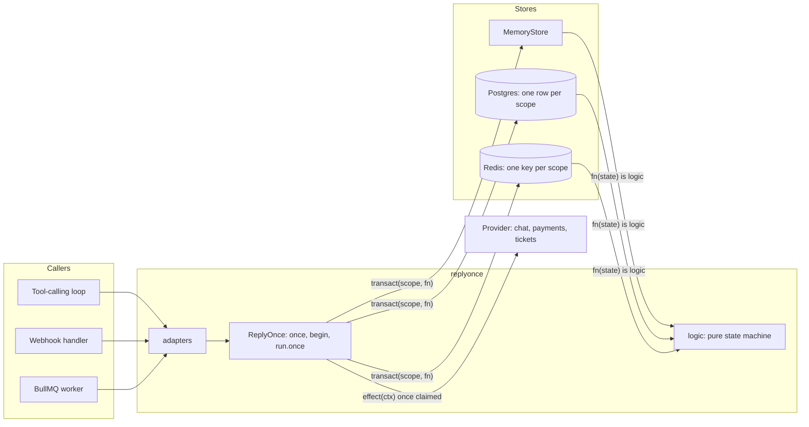

# Architecture

Two libraries, one state machine.

| Path | Owns |
| --- | --- |
| `src/logic.ts` | The pure state machine: claims, fencing, the conversation fence, ambiguous outcomes |
| `src/replyonce.ts` | `createReplyOnce`, `once`, runs, reconciler calls, events |
| `src/key.ts` | Canonical JSON, effect keys, provider idempotency keys |
| `src/stores/` | Memory, Postgres (row lock), Redis (Lua compare-and-set) |
| `src/adapters/` | Tool-call loops, webhooks, BullMQ |
| `src/demo.ts`, `src/cli.ts` | The chaos demo and `replyonce demo` |
| `python/src/replyonce/` | The same machine for asyncio workers (`_logic.py` ports `logic.ts`) |
| `scripts/interop.ts`, `python/scripts/interop.py` | Node and Python sharing one store |
| `examples/` | Quickstart, agent loop, webhook, Postgres, BullMQ |
| `infra/docker/` | The Node 22 and Python 3.12 images |

Each scope (usually a conversation) is one JSON state document holding its
runs and its effect ledger. Every decision is a store `transact(scope, fn)`:
the store reads the document, `fn` is a pure function from `logic.ts`, and
the store writes the next document atomically. Stores hold no decision logic,
so all three behave the same and share one test suite.

A run holds a fencing token for its scope. A newer run or a redelivery takes
the token, and the old run's writes are refused. An effect is stored under
its business identity (the order, the message), not under a tool-call id. A
timeout after the provider may have acted is `ambiguous` until a reconciler
or a person resolves it. The README has the claim order and the effect state
diagram.

Node and Python persist the same state format and hash keys identically, so
they can share one Postgres table or Redis prefix. Numbers follow ECMAScript
`Number::toString`: shortest round-trip digits, decimal notation down to
`1e-6` (inclusive) and below `1e21`, exponent notation outside that range,
with no zero-padded exponent (`1e-7`, not `1e-07`). Python renders floats with
those same rules and normalises integers above 2**53 through a double, so a
JSON number token produces one ledger key in both languages. Cross-language
vectors are frozen in `python/tests/test_key.py` and `test/key.test.ts`.
