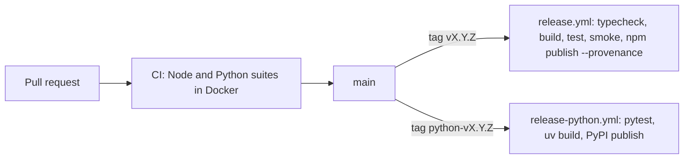

# Deployment

This is a library, not a hosted service. There is no staging server and no
production container to promote.

- **npm.** Push a `v*` tag that matches `package.json` `version`.
  `.github/workflows/release.yml` checks the tag, runs typecheck, build,
  tests (memory, Postgres, Redis) and smoke on Node 24, then publishes with
  npm trusted publishing and a provenance attestation. `prepublishOnly` runs
  the same checks for a manual publish.
- **PyPI.** Push a `python-v*` tag that matches `python/pyproject.toml`
  `version`. `.github/workflows/release-python.yml` runs pytest on Python
  3.13, builds the sdist and wheel, and publishes with PyPI trusted
  publishing.
- The two packages are versioned separately. `CHANGELOG.md` says which
  package each entry is for.
- Release jobs run on the runner, not in the compose images. Their Postgres
  and Redis come from `.github/actions/backends`.

Neither workflow stores a registry token. Rollback of a published version is
a new release. Rollback of `main` is `git revert`.
